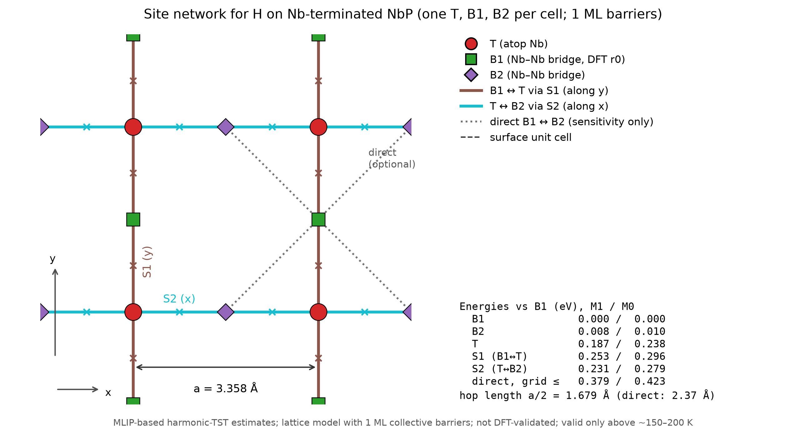
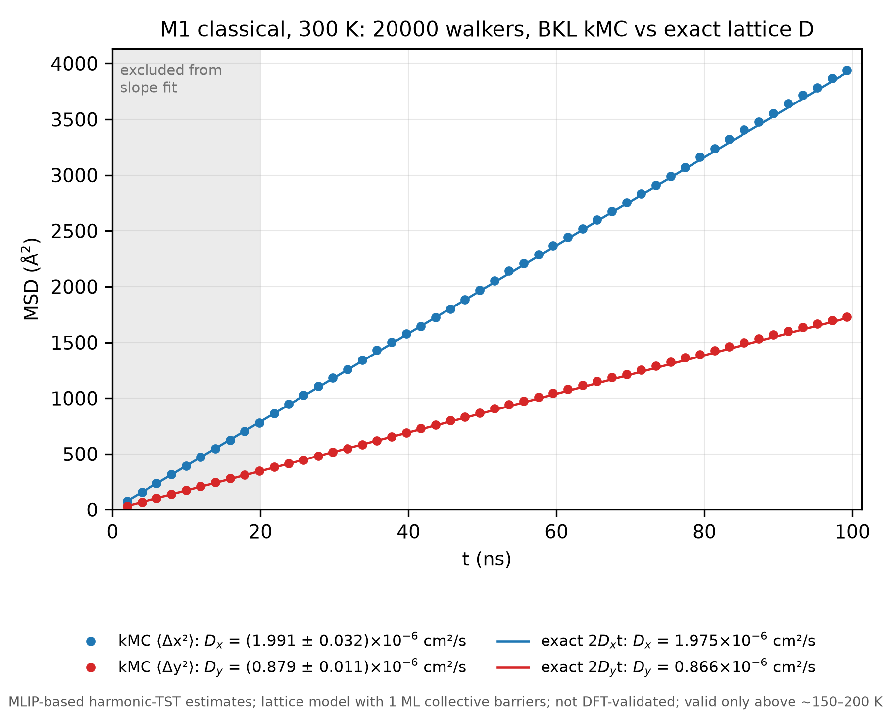
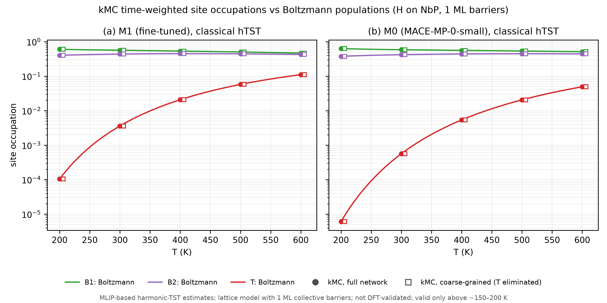
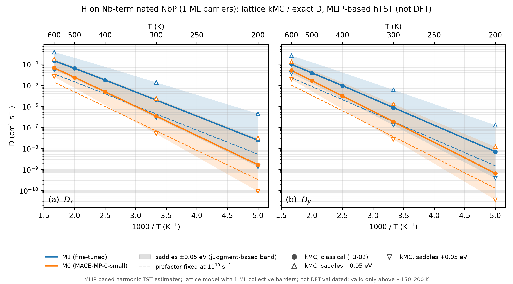

# MLIP-based H surface diffusion estimate on NbP (harmonic TST + kMC)

This page turns the MLIP-driven CI-NEB pathway of
[`NEB_PATHWAY.md`](NEB_PATHWAY.md) into a temperature-dependent diffusion
coefficient. The result is **an MLIP-based, harmonic-TST, lattice-kMC estimate
of H surface diffusion on the Nb-terminated NbP slab with 1 ML collective
barriers, not a measured or DFT-validated value.** No new DFT and no new MACE
calculations were run: every input comes from the committed NEB key points
(energies and H-only modes at B1, S1, T, S2, and B2 for M0 and M1).

The ±0.05 eV band used below is **a judgment-based range for the MLIP barrier
error, not a statistical error bar.** The model is valid only above about
150–200 K (tunnelling crossover 85–101 K), so results are reported for
200–600 K. The kMC validation is **internal**: it shows that the kMC engine
reproduces the exact solution of the same lattice model, and says nothing
about whether the rates are right.

## From pathway to diffusion coefficient

```text
MACE (M0, M1) → CI-NEB minima and saddles + H-only modes → harmonic-TST rates
             → lattice master equation (exact) and kinetic Monte Carlo → D_x(T), D_y(T)
```

Each step is a standard production technique; the point of the exercise is
the full chain, its validation, and an honest account of where the
uncertainty enters. Because the site network is small, D(T) can be computed
exactly. The exact solution is the reference that the from-scratch kMC engine
must reproduce, and the engine is what would carry over to networks with no
closed form (larger cells, coverage effects, reactions).

## Site network and rates



*Per surface cell (a = 3.358 Å) there is one atop site T and two Nb–Nb
bridges, B1 (the DFT-anchored r0 site) and B2. B1 ↔ T hops cross S1 along y,
T ↔ B2 hops cross S2 along x; each hop is a/2. The dotted direct B1 ↔ B2 route
is used only in the sensitivity analysis. Energies are the CI-NEB key points
relative to B1 (M1 / M0), classical, without ZPE.*

Hollow sites are excluded (the hollow is the maximum of the lateral map,
+1.1 eV). Rates use classical harmonic transition-state theory with the
Vineyard prefactor ν = Π ν_min (3 H modes) / Π′ ν_saddle (2 real H modes), from
the H-only Hessians of the NEB analysis (substrate frozen):

| Model | Hop | Eₐ (eV) | ν (s⁻¹) | k(300 K) (s⁻¹) |
|---|---|---:|---:|---:|
| M1 | B1 → T | 0.253 | 4.8 × 10¹³ | 2.7 × 10⁹ |
| M1 | T → B1 | 0.066 | 5.5 × 10¹² | 4.3 × 10¹¹ |
| M1 | T → B2 | 0.044 | 5.4 × 10¹² | 9.8 × 10¹¹ |
| M1 | B2 → T | 0.223 | 4.4 × 10¹³ | 8.0 × 10⁹ |
| M0 | B1 → T | 0.296 | 5.2 × 10¹³ | 5.6 × 10⁸ |
| M0 | T → B1 | 0.058 | 5.5 × 10¹² | 5.8 × 10¹¹ |
| M0 | T → B2 | 0.041 | 5.3 × 10¹² | 1.1 × 10¹² |
| M0 | B2 → T | 0.270 | 4.9 × 10¹³ | 1.5 × 10⁹ |

Forward and reverse rates satisfy detailed balance with the harmonic site
partition functions to 7 × 10⁻¹⁵ (relative). At 300 K (M1) the Boltzmann
populations are B1 0.560, B2 0.436, and T 0.0036; T reaches 11% at 600 K.
Sensitivity variants (below) use quantum-harmonic partition functions (ZPE
included), a Wigner tunnelling factor, or a fixed prefactor of 10¹³ s⁻¹.
Full tables: [`artifacts/kmc/01_rates/rates/`](../artifacts/kmc/01_rates/rates/).

## Exact solution and kMC validation

**Exact D.** For a periodic network, D is the curvature at k = 0 of the
slowest eigenvalue of the Bloch master-equation generator. It is evaluated by
second-order perturbation theory and cross-checked by finite differences of
the numerical eigenvalue (agreement 8 × 10⁻⁸) and by the closed form for this
star network, D_x = (a²/2) p_T k(T→B2) and D_y = (a²/2) p_T k(T→B1), where p_T
is the Boltzmann population of T (agreement 2 × 10⁻¹³).

**kMC.** A rejection-free BKL (residence-time) algorithm was written from
scratch: 20 000 independent walkers in unwrapped coordinates, about 2000
events each, D from the late-time slope of the mean-square displacement, and
standard errors from 32 independent walker batches. A coarse-grained variant
eliminates T through its splitting probabilities and adds the mean T dwell
time to the clock, which keeps the long-time D exact.

| Check (all pass at \|z\| < 4) | Largest \|z\| |
|---|---:|
| Time-weighted site occupations = Boltzmann populations | 2.66 |
| Residence times exponential with mean 1/Σk (plus KS test, p ≥ 0.11) | 1.29 |
| kMC D_x, D_y = exact D (M1 200–600 K, M0, quantum variant) | 1.67 |
| Coarse-grained model = full model | 1.74 |
| Limits: equal saddles give D_x = D_y; no S2 events give D_x = 0 exactly | 0.32 |
| Production run, M1 and M0, 200–600 K, full and coarse-grained (40 comparisons) | 2.90 |
| Spot checks of every sensitivity variant, 200/300/600 K (66 cases, 132 D values) | 2.85 |
| Same spot checks, site occupations (198 values) | 3.98 |

The statistical precision is about 1–1.5% of D per run. Over the 132
spot-check D comparisons the z-scores have mean +0.12 and standard deviation
0.97, so the error bars are honest. The largest occupation z (3.98) is the T
occupation for M0 with the 10¹³ prefactor at 600 K: a 0.1% relative deviation,
inside the pass criterion and consistent with a tail draw among 198
correlated comparisons. During development, the residence-time check caught a
real bug (long waits censored at the end of the run), which was fixed.



*MSD of H along x and y from kMC (M1, classical, 300 K) with the exact lines
2D_x t and 2D_y t. kMC gives D_x = (1.991 ± 0.032) × 10⁻⁶ and
D_y = (0.879 ± 0.011) × 10⁻⁶ cm²/s against exact 1.975 × 10⁻⁶ and
0.866 × 10⁻⁶. This validates the engine, not the rates.*



*Time-weighted kMC site occupations (full and coarse-grained) versus the
Boltzmann populations from the same partition functions, M1 and M0.*

One engineering finding: coarse-graining saves only 2.7–3.0× in events and
about 2.2–2.5× in wall time, not the ~500× suggested by T living 500× shorter
than the bridges. In a rejection-free scheme short lifetimes cost no extra
events; only fast back-and-forth flicker does, and this network has none
(T → bridge is fast but bridge → T is slow). The coarse-grained construction
is kept as the template for networks that do flicker.

## Results



*Tracer D_x (a) and D_y (b) versus 1000/T. Lines: exact lattice solution with
classical Vineyard harmonic-TST rates, M1 and M0. Shaded: all saddles shifted
by ±0.05 eV with the minima fixed (judgment-based range, not a statistical
error bar). Dashed: prefactor fixed at 10¹³ s⁻¹. Symbols: kMC with standard
errors. MLIP-based estimates with 1 ML collective barriers; not DFT-validated;
valid only above ~150–200 K.*

### Headline at 300 K (M1, classical Vineyard harmonic TST)

| Quantity | Main | ±0.05 eV barrier band |
|---|---:|---:|
| D_x (cm²/s) | 2.0 × 10⁻⁶ | 2.9 × 10⁻⁷ – 1.4 × 10⁻⁵ |
| D_y (cm²/s) | 8.7 × 10⁻⁷ | 1.3 × 10⁻⁷ – 6.0 × 10⁻⁶ |
| D_x / D_y | 2.3 | 2.3 (unchanged) |
| Eₐ,eff, x / y (Arrhenius fit 200–600 K) | 0.225 / 0.246 eV | 0.175–0.275 / 0.196–0.296 eV |
| D₀, x / y | 1.2 × 10⁻² cm²/s | — |

M0 gives D_x = 3.4 × 10⁻⁷ and D_y = 1.9 × 10⁻⁷ cm²/s at 300 K (Eₐ,eff 0.274 /
0.291 eV), 5.8× (x) and 4.7× (y) below M1 and inside M1's ±0.05 eV band at
every temperature from 200 to 600 K. Over 200–600 K, M1's D_x runs from
2.4 × 10⁻⁸ to 1.4 × 10⁻⁴ cm²/s. Eₐ,eff lies slightly below the bare saddle
energy (0.225 vs E(S2) = 0.231 eV) because B2, 0.008 eV above B1, holds 44% of
the population; the Arrhenius plot is slightly curved (max |Δln D| = 0.05).

### How wide the band is, and what drives it

The band width in factors relative to the main M1 curve (x and y agree within
0.1):

| Band | 200 K | 300 K | 600 K |
|---|---:|---:|---:|
| Saddles ±0.05 eV | ÷18 / ×18 | ÷6.9 / ×6.9 | ÷2.6 / ×2.6 |
| Saddles ±0.05 eV and fixed 10¹³ s⁻¹ prefactor | ÷85 / ×18 | ÷32 / ×6.9 | ÷11 / ×2.6 |

D(variant) / D(main), M1, x / y:

| Source | 200 K | 300 K | 600 K |
|---|---:|---:|---:|
| Saddles −0.05 / +0.05 eV | ×18 / ÷18 | ×6.9 / ÷6.9 | ×2.6 / ÷2.6 |
| Prefactor 10¹³ s⁻¹ instead of Vineyard | 0.22 / 0.21 | 0.22 / 0.21 | 0.24 / 0.24 |
| M0 instead of M1 | 0.068 / 0.094 | 0.17 / 0.21 | 0.46 / 0.52 |
| Quantum-harmonic (ZPE) | 3.9 / 3.8 | 1.8 / 1.8 | 1.10 / 1.10 |
| Wigner tunnelling factor | 1.30 / 1.42 | 1.13 / 1.19 | 1.03 / 1.05 |
| Quantum-harmonic × Wigner | 5.0 / 5.4 | 2.0 / 2.1 | 1.14 / 1.15 |

- **The barrier uncertainty dominates,** and it grows as T falls
  (exp(0.05 eV / k_BT)). The prefactor choice comes next (a near-constant
  factor of ~0.2): Vineyard's effective bridge attempt frequency is
  ~4.6 × 10¹³ s⁻¹, not 10¹³. Because M1's bridge modes are too stiff (the DFT
  B1 frequency product is ~0.54 of M1's), the true prefactor could be ~2×
  lower, if the saddle modes are less affected (unknown).
- **The M0–M1 spread is comparable to the ±0.05 eV band.** That is consistent
  with the judgment behind the band, not a validation of it.
- **Quantum corrections stay inside the band at every T.** They come mostly
  from the large bridge ZPE, which M1 overestimates, so this factor is itself
  uncertain.

### Direct B1 ↔ B2 route

Adding direct diagonal hops at the straight-line maximum of the
frozen-substrate lateral map (0.379 eV for M1, 0.423 eV for M0, an upper
estimate, with ν = 10¹³ s⁻¹) changes D by at most 0.3% at 300 K and 3.6% at
600 K. Even a deliberately generous version (saddle 0.05 eV lower, Vineyard
prefactor) gives +5% / +10% (x / y) at 300 K and +31% / +46% at 600 K, still
inside the ±0.05 eV band, so the star network B1–T–B2 is kept.

### Anisotropy

In this MLIP landscape D_x / D_y ≈ 2.3 (M1) or 1.9 (M0) at 300 K, because
x-motion crosses the lower saddle S2 and y-motion crosses S1. The ratio does
not change under uniform saddle shifts or the prefactor choice (2.28–2.32).
It rests entirely on E(S2) < E(S1), a 0.02 eV difference that no DFT data
test. It is a prediction of the MLIP energies, not a validated property.

## What is and is not validated

| Claim | Status |
|---|---|
| kMC engine reproduces the exact lattice solution (D, occupations, residence times, limits) | Validated internally, all checks \|z\| < 4 |
| Exact D: Bloch solution = closed form = finite differences | Validated to ≤ 8 × 10⁻⁸ |
| Rates satisfy detailed balance | Exact by construction, checked to 7 × 10⁻¹⁵ |
| Saddle and T energies, H modes off B1 | **Unvalidated MLIP estimates** (no DFT data off B1) |
| ±0.05 eV barrier range | Judgment from the NEB error analysis, not a measured error |
| Anisotropy D_x / D_y | Rests on E(S2) < E(S1); untested |
| Coverage dependence | Not computed (single walker on 1 ML barriers) |

## Caveats

- **Coverage mismatch (main caveat).** The barriers are for 1 ML collective
  motion in a 1×1 cell, where every periodic H image moves together. The kMC
  follows one walker. The result is a lattice model parameterised with 1 ML
  collective barriers, not a dilute-limit (isolated-adatom) value.
- All energies are MLIP estimates; the only DFT anchor is B1. Every NEB caveat
  applies: M1 stiffness errors (which affect the bridge prefactor and ZPE),
  the SOC-geometry / collinear-label inconsistency in M1's training data, and
  no H2 reference.
- Harmonic TST with H-only Hessians (substrate frozen), no recrossing
  correction; the Wigner factor is a leading-order correction only.
- Tracer diffusion on an ideal terrace: no H–H interactions, subsurface sites,
  defects, or steps.
- The direct-route saddle comes from a coarse (0.28 Å), frozen-substrate grid
  along a straight line, not an NEB; hence two bracketing variants.
- Valid only above ~150–200 K; below ~150 K tunnelling dominates and this
  model does not apply.
- The kMC validation is internal (engine versus the exact solution of the
  same model).

## Future work

1. **DFT single points at S1, T, S2, and B2** (and H-only modes at S1 and T),
   pending compute access. These would test the barriers, the anisotropy,
   and the prefactor at once.
2. **¼ ML coverage check (MACE only, skipped for now).** One H in a 2×2 cell:
   relax B1/T/B2, CI-NEB B1 → T → B2, and H-only modes with M1, then rerun the
   pipeline unchanged with the new key points. This would turn the coverage
   caveat into a measured 1 ML → ¼ ML effect and give a dilute-limit estimate.
3. **H/D isotope effect.** With H-only Hessians the frequencies scale by 1/√2;
   quantum-harmonic TST then gives a non-trivial kinetic isotope effect. This
   is a change to the rate script only.
4. Optional: a B1 → B2 CI-NEB with M1 to replace the grid estimate of the
   direct route (not needed at the current level of uncertainty).

## Reproduce

Scripts are in [`src/kmc/`](../src/kmc/) and the commands, run order, and
runtimes are in [`RUNBOOK.md`](../RUNBOOK.md) section 9. The pipeline needs
only NumPy, SciPy, and Matplotlib and reads the committed Track 1 artifacts
(`artifacts/neb/03_analysis/key_points.json` and the lateral maps); no
checkpoint, coordinate file, or DFT output is required. Exact results are
deterministic, and the kMC runs use fixed seeds. Committed summaries and
figures are in [`artifacts/kmc/`](../artifacts/kmc/), each JSON with input
SHA-256 hashes and package versions. Generated 2026-11-09 (Python 3.12.13,
NumPy 2.5.2, SciPy 1.18.1, Matplotlib 3.11.1).

Script docstrings refer to the internal steps T3-01 (rates and exact D),
T3-02 (kMC engine and tests), and T3-03 (sensitivity, spot checks, figures);
"scope section 3" is the set of preliminary numbers computed before the work
and kept as a regression check.
