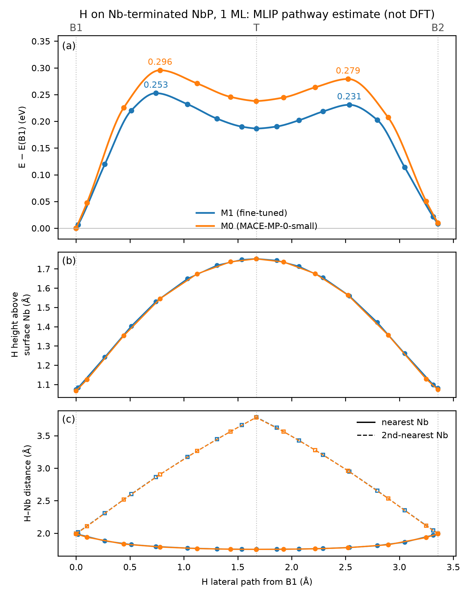

# MLIP-driven CI-NEB pathway estimate for H on NbP

This page extends the frozen one-dimensional r0--r8 scan into a lateral
minimum-energy path for hydrogen on the Nb-terminated NbP slab. Every energy,
geometry, and frequency reported here is an **MLIP pathway estimate** from M0
(MACE-MP-0-small, no fitting) or M1 (the five-epoch fine-tune described in the
main README). No new DFT was run. DFT values are quoted only where they already
existed in the audited r0--r8 data and the collinear finite-difference
calculation at r0.

The page answers one question: if M1 is used the way an MLIP is used in
production, as a cheap force field for pathway exploration, what diffusion path
and saddle does it predict for H on this surface, and how much of that answer
can the existing DFT data support?

## System and coverage

- The slab is the DFT cell used for r0--r8: 1×1 in-plane cell
  (a = 3.358 Å), 56 layers with one atom each, Nb-terminated. The bottom 16
  atoms keep the same fixed flags as the DFT relaxations.
- One H per cell means **1 ML coverage**. Every periodic image of H moves
  together, so the path describes collective motion of a full monolayer, not
  isolated-adatom diffusion.
- Sites are named by fractional position relative to the top Nb at
  (0.5, 0.5): **B1**, the Nb--Nb bridge above the layer-4 P (the DFT r0 site);
  **B2**, the rotated Nb--Nb bridge above the layer-3 Nb; **T**, atop the
  surface Nb; **H4**, the four-fold hollow above the layer-2 P.

## Method

1. **Lateral map.** A 12×12 grid (0.28 Å spacing) on the frozen DFT
   substrate, with the H height relaxed at each grid point, was computed with
   both models. The two maps are nearly identical, so the lateral landscape is
   the foundation-model prior rather than something learned from the
   fine-tuning data. The hollow H4 is the highest point on the map (+1.1 eV),
   so the B1 → H4 direction is not a path. The lowest route is
   B1 → T → B2, with a grid minimax estimate of 0.28 eV (M1) and 0.32 eV (M0).
   This is a frozen-substrate, coarse-grid upper estimate.
2. **Endpoints.** B1, B2, and T were relaxed with the substrate free
   (fmax 0.005 eV/Å, H started 0.05 Å off-site). All three return to their
   sites. B2 lies +0.008 eV above B1 (M1) and T is a shallow minimum.
3. **Split-band CI-NEB.** Because T is a relaxed minimum in both models, the
   path was run as two bands, B1 → T and T → B2, with T as a shared endpoint.
   Initial bands are linear interpolations (IDPP was avoided because
   minimum-image pairs can flip in a 3.36 Å cell). ASE 3.29 NEB with the
   improved tangent, k = 0.1 eV/Ų, and FIRE (maxstep 0.1 Å) was converged to
   0.03 eV/Å as plain NEB and then to 0.01 eV/Å with a climbing image. M1 used
   9 images per band and M0 used 7. MACE ran in float64 on a laptop CPU at
   about 1--2 s per force call, or 7--11 min per band.
4. **H-only modes and ZPE.** A 3×3 Hessian of the H coordinates (central
   differences, 0.01 Å, substrate frozen at each image) was evaluated at B1,
   both saddles, T, and B2. The same H-only convention was used to compare M1
   with the DFT finite-difference modes at r0.

## Results

Energies are relative to B1 for the same model. S1 is the B1 → T saddle and
S2 is the T → B2 saddle. *h* is the H height above the surface Nb.

| Model | Point | E (eV) | E + ZPE(H) (eV) | h (Å) | H modes (cm⁻¹) |
|---|---|---:|---:|---:|---|
| M1 | B1 | 0 | 0 | 1.074 | 544 x, 1232 y, 1448 z |
| M1 | S1 | 0.253 | 0.187 | 1.530 | 443i y, 330 x, 1827 z |
| M1 | T | 0.187 | 0.125 | 1.753 | 245 x, 263 y, 1724 z |
| M1 | S2 | 0.231 | 0.165 | 1.560 | 371i x, 338 y, 1817 z |
| M1 | B2 | 0.008 | 0.002 | 1.081 | 572 y, 1099 x, 1449 z |
| M0 | B1 | 0 | 0 | 1.067 | 542 x, 1283 y, 1492 z |
| M0 | S1 | 0.296 | 0.224 | 1.545 | 428i y, 323 x, 1844 z |
| M0 | T | 0.238 | 0.171 | 1.752 | 245 x, 255 y, 1731 z |
| M0 | S2 | 0.279 | 0.208 | 1.563 | 384i x, 332 y, 1836 z |
| M0 | B2 | 0.010 | 0.004 | 1.074 | 570 y, 1165 x, 1498 z |

S1 for M1 is 0.2525 eV and is quoted as ≈ 0.25 eV. The machine-readable table
is [`artifacts/neb/03_analysis/key_points.json`](../artifacts/neb/03_analysis/key_points.json).

*Energy relative to B1 (a), H height above the surface Nb (b), and the nearest
and second-nearest H--Nb distances (c) along the lateral H path, a/2 per
segment. MLIP estimates, not DFT. Curves are monotone (PCHIP) interpolations
through the NEB images and only guide the eye. H--Nb distances include in-plane
periodic images: in a 1×1 cell the two bridge Nb are one atom and its image.*

What the calculation shows:

- **The rate-limiting point in both models is S1 (B1 → T):** classical
  ≈ 0.25 eV for M1 and 0.30 eV for M0. Freeing the substrate lowers it by about
  0.03 eV relative to the frozen-substrate grid estimate.
- **T is a shallow intermediate.** Its well is 0.066 eV deep toward B1 and
  0.044 eV toward B2 (M1). It survives the H-only ZPE correction in both models
  (0.062 / 0.040 eV for M1).
- **The path is a coordination switch.** H goes from two Nb at ≈ 1.99 Å on
  the bridge to one Nb at 1.75 Å atop T, with the next Nb at ≈ 3.8 Å. Both
  saddles sit at h ≈ 1.53--1.56 Å with a nearest H--Nb distance of
  ≈ 1.78--1.80 Å.
- **Geometry is model-independent.** M0 and M1 give the same H height profile
  (1.07 → 1.75 → 1.08 Å), the same H--Nb distances, the same saddle positions,
  and the same imaginary-mode axes. Fine-tuning moved the energetics, not the
  path: every point off B1 drops by 0.04--0.05 eV, mostly by stabilizing T, and
  the classical S1 estimate falls by about 15%.
- **Each saddle has exactly one imaginary H mode** along the expected axis
  (y for S1, x for S2).

## What is and is not validated

| Quantity | DFT reference available? | Status |
|---|---|---|
| B1 is a minimum at 1 ML | Yes, all three collinear DFT H modes at r0 are real | Consistent |
| H height at B1 (frozen substrate) | DFT 1.173 Å | M1 1.072 Å, 0.10 Å too low |
| Vertical curvature at B1 | DFT k ≈ 4.1 eV/Ų | M1 7.5 eV/Ų, ~1.8× too stiff |
| H modes at the DFT geometry | DFT z 1068, x 642, y 767 cm⁻¹ | M1 +17%, −3%, −19% |
| H modes at M1's own minimum | Same DFT modes | M1 z +36%, y **+61%**, x −15% |
| Substrate response | DFT r0 geometry | M1 shifts the free block rigidly by 0.3--0.4 Å (≈ 0.5--0.7% shorter c); identical constraints on every image make this cancel in relative energies |
| B2, T, S1, S2, the ridges | **None** | Unvalidated MLIP estimates |

Every DFT H trajectory in the source data moves H only vertically above B1.
The NEB path therefore runs entirely through territory the training data never
sampled, and it crosses exactly the directions (y and z stiffness) where M1 is
measurably most wrong. Because M0 and M1 agree off B1, the fine-tuning data
cannot arbitrate between them there. The error of the saddle energies is
unknown and plausibly tens of percent.

## ZPE caveat

The H-only ZPE correction lowers M1's S1 by 0.066 eV, but most of that comes
from the large B1 ZPE. M1's B1 y and z modes (1232 and 1448 cm⁻¹) are the known
stiffness errors (DFT 767 and 1068 cm⁻¹ at the DFT geometry), and those errors
alone inflate the B1 ZPE by about 0.05 eV. The saddle modes have no DFT
reference. The honest statement is: **the classical MLIP pathway estimate for
S1 is ≈ 0.25 eV, and an H-only ZPE estimate lowers it by an amount M1's
stiffness errors make uncertain, roughly 0.02--0.07 eV.**

## Caveats

- MLIP-only; no DFT labels exist anywhere along the path except at B1.
- 1 ML coverage in a 1×1 cell with collective H motion. Lower coverages or
  larger cells may change both the path and the energetics.
- H-only Hessians (substrate frozen) for all modes and ZPE values.
- M1's training labels inherit the repository's SOC-geometry,
  collinear-energy inconsistency.
- No converged H2 reference exists, so no adsorption or desorption energy is
  reported, and this path says nothing about H2 recombination.
- Classical energies on a static surface; no temperature, entropy, tunneling,
  or rate constants.

## Future work, pending compute access

These items require new DFT and are blocked until cluster and VASP/QE access
returns:

1. Collinear DFT single points at S1, T, S2, and B2 using the MLIP geometries.
   This is the cheapest test of the whole pathway estimate.
2. DFT H-only modes at S1 and T, which would settle the ZPE correction.
3. A converged, isolated H2 reference, to report an adsorption energy.
4. Reconciliation of SOC geometries with collinear labels.

## Reproduce

Scripts are in [`src/neb/`](../src/neb/) and reproduction commands are in
[`RUNBOOK.md`](../RUNBOOK.md) section 8. Coordinate files (`*.extxyz`,
`*.traj`) and model checkpoints stay local under the repository data policy.
Every committed JSON summary carries the M1 checkpoint SHA-256 (fa762686…cf8d)
and package versions. Generated 2026-10-09 (endpoints) and 2026-10-10 (NEB and
analysis).
